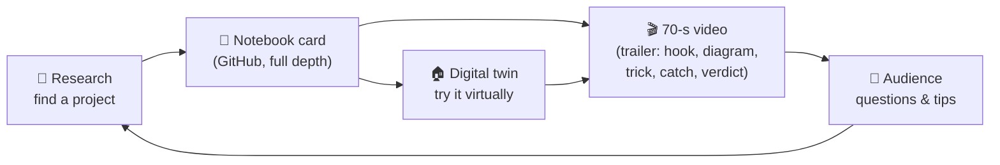
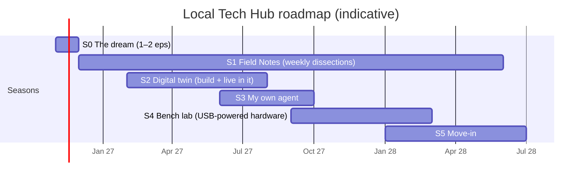
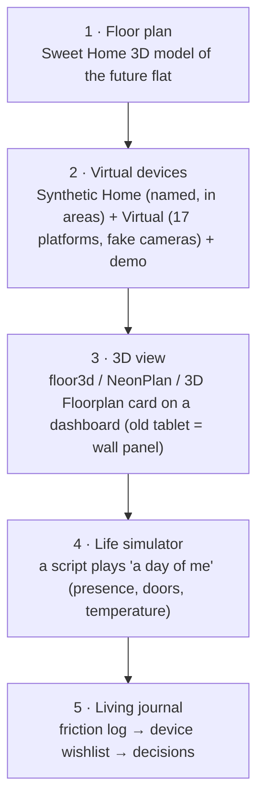

# Local Tech Hub: Content & Research Report

> **For:** me (reading in the PDF) and my AI assistant (this Markdown file is the source of truth).
> **Date:** 2026-11-11. Every project fact below was checked against the project's own README or official Home Assistant (HA) docs on this date. These projects change fast, so re-check a project before filming it.
> **Status labels used below:** ✅ = verified from the primary source (README or official docs) · ⚠️ = second-hand (forum or Reddit summary; I couldn't open the original) · 💭 = my own suggestion or opinion.

---

## 0. One-page summary

| | |
|---|---|
| **The idea** | I get my keys in **2028**. Until then I **research, simulate and document** how to turn my home into a **Local Tech Hub**: a place to try out interesting technology, approached as a software engineer. |
| **The format** | Faceless short videos (~60–90 s), plus a **public notebook** (this GitHub repo) that holds the technical depth. The video is the trailer; the notebook is the full story. |
| **Why it can work** 💭 | Most smart-home content I've seen shows *that* something is cool. I'll show *how it works*: a diagram, the one clever trick, and the catch. My edge is the engineering point of view. (This is my impression, not a market study. See §8 for a 30-minute way to check it.) |
| **The arc** | **S0** The dream → **S1** Field Notes (dissect other people's projects, weekly) → **S2** Digital Twin (move in virtually before I have keys) → **S3** My own agent → **S4** USB-powered bench lab → **S5** Move-in 2028: twin vs reality. |
| **First 12 episodes** | 1 intro + 11 project dissections, all verified and ready to script (§4). |
| **Season 2 hook** | "Living" in a simulated version of my future home to find out what I actually need (TV? speakers? sensors where?) before spending money or making renovation decisions. |
| **Effort** 💭 | About 3–5 hours per dissection episode (research → notebook card → 70-second script → screen recording → edit). A sustainable pace next to a full-time job is **1 episode a week**. |

---

## 1. The concept

**Local Tech Hub** = my future home, used as a lab. The channel documents the journey *before* the lab exists:

1. **Research in public.** I find interesting projects, take them apart, and file what I learn in my notebook.
2. **Simulate.** I build a digital twin of my home and "live" in it to discover what I'd really use.
3. **Build.** I write my own pieces (an AI agent, small USB-powered gadgets).
4. **Move in (2028).** I compare what the twin predicted with reality.

The notebook is the **thread through every episode**: each one ends with "→ filed in my notebook as *Must-have / Maybe / Just cool*". Over time this builds a public, searchable knowledge base, which is a real asset for a personal brand. It also covers depth: a 70-second video can't hold real technical detail, but the notebook page it links to can.



---

## 2. The long arc: Nov 2026 → keys in 2028



| Season | What happens | Example episode | Notes |
|---|---|---|---|
| **S0 The dream** | Who I am, the 2028 keys, why a "tech hub", why I'll share it | "In 2028 I get my keys. Until then, I'm building my home in software." | 1–2 episodes. Script draft in §9. |
| **S1 Field Notes** | One dissection a week of someone else's project (§4) | "A house run by five AI characters: how it actually works" | Runs in parallel with the other seasons; it's the backbone. |
| **S2 Digital twin** | Build the twin, then live in it (§5) | "Day 1 living in a home that doesn't exist" | Starts once 6–8 S1 episodes give enough ideas to test. |
| **S3 My own agent** | My Phase 1 agent plan (`docs/phase1/`), now as a season | "Why my AI isn't allowed to unlock my door" | The existing plan's dates (Nov 21 / Dec 5 / Dec 19, 2026) can move; your call (see §10). |
| **S4 Bench lab** | Low-voltage, USB-powered gadgets on a desk (ESP32 + LED strip, DIY presence sensor) | "My first real device cost ~$15 and needs no electrician" | Hardware, but no mains electrical work. |
| **S5 Move-in** | Real devices; twin predictions vs reality | "What the simulation got wrong" | Dates depend on the handover. |

---

## 3. Episode formats (all faceless)

### Format A: Dissection (the S1 workhorse), about 70–90 s

| Time | Beat | What's on screen |
|---|---|---|
| 0–3 s | **Hook**: the surprising result ("This house argues with its owner about bedtime.") | The project's own demo clip/GIF (credited), or my reproduction in the twin |
| 3–15 s | **What it does**, in one sentence | Title card + project name + creator credit |
| 15–45 s | **How it works**: one diagram, 3–5 boxes | An animated diagram I draw myself (Excalidraw or Mermaid) |
| 45–60 s | **The clever trick**, the one idea worth stealing | Zoom on one config/code snippet |
| 60–75 s | **The catch**: cost, hardware, maturity, privacy | Text overlay with the facts and their date |
| 75–90 s | **Notebook verdict**: Must-have / Maybe / Just cool + why, for *my* home | My notebook card scrolling past |

### Format B: Build log (S2–S4)
"I tried X → it broke at Y → here's the fix." Screen recording + voiceover. Showing failures is fine; they make it more credible.

### Format C: Day in the twin (S2)
A time-lapse of a simulated day in the 3D twin. Lights follow the simulated "me", with captions such as "08:30: I wished the house told me it's going to rain."

### Format D: Myth vs reality (any time)
"Can AI really learn your habits?" Answer it with what's verified today, not hype.

**Production checklist (every episode):**
- [ ] Credit the creator by name and link the repo or post (in the video and the description)
- [ ] Date-stamp facts ("as of Nov 2026"), especially versions, prices and models
- [ ] Say clearly when I haven't tested something myself ("I haven't run this yet; this is from the README")
- [ ] Use my own diagrams and reproductions; ask before reusing someone's screenshots or video
- [ ] Never show tokens, IP addresses, my address, or my real floor plan (§8)
- [ ] Link to the notebook card for the full technical breakdown

---

## 4. Project dossier: Season 1 candidates (verified)

Each card answers the same questions, which makes scripting fast. "Try in twin" asks whether I can reproduce it before I have keys.

### 4.1 Project Fronkensteen: five AI personas run a house ✅
- **Source:** github.com/mmadalone/Project_Fronkensteen · HA community post "Five AI Personas Run My House from a RPi 5"
- **What it does:** Five character personas, each with its own conversation agent, voice and time-of-day mood, run one house from a **Raspberry Pi 5**. Among other things they "argue with you about bedtime" and route notifications to whichever room you're in.
- **How it works:**
  - **Engine vs features:** ~38 **pyscript** Python modules (168 services) form the engine; about 80 automation blueprints and 35 script blueprints are the features. There are 22 Assist voice pipelines in total.
  - **LLM:** the *Extended OpenAI Conversation* integration (community) calling **Llama 4 Maverick via OpenRouter**, with **ElevenLabs** voices.
  - **Agent dispatcher:** a 7-priority router decides which persona answers (explicit handoff → wake word → keyword memory → user continuity → time of day …).
  - **Three-layer context** assembled before every reply: L1 "hot" (time, presence, media, weather), L2 "warm" (**SQLite + FTS5 + sqlite-vec**: preferences, history), L3 "cold" (Google Calendar, Gmail, forecasts).
  - **Presence:** Aqara FP2 mmWave zones plus Wi-Fi tracking to infer *who* is in *which* room.
- **The clever trick:** **Email safety.** Email is attacker-controlled text arriving at an agent that can call tools, so the reader returns **subjects only** by default, and a body needs an explicit follow-up. This is a real prompt-injection defense.
- **The catch:** Huge scope. The author says it's in "early stages of testing", and states "Zero lines of hand-written YAML. All code generated by Claude." It relies on paid cloud services (OpenRouter, ElevenLabs), although it does track the budget per agent.
- **Try in twin:** Partly. The personas and the dispatcher idea, yes; presence and voice hardware, no.
- **Video angle:** "A house run by five AI characters, and the one security trick worth stealing."
- **My verdict (draft):** *Just cool → steal two ideas* (the context layers and the email safety rule).

### 4.2 ZenOS-AI ("Friday's Party"): an AI that summarises your whole house ✅
- **Source:** github.com/nathan-curtis/zenos-ai · HA community thread "Friday's Party"
- **What it does:** An HA-native framework for a "private, context-aware, agentic" assistant with a team of personas (Friday plus others). Stable release **2026.10.2 "Tron"**.
- **How it works:**
  - Built entirely from **HA Packages** (YAML config bundles) and scripts ("DojoTools"). No separate server.
  - **Memory = "Cabinets" with "Drawers":** typed, described slots stored inside HA and garbage-collected every 15 minutes.
  - **Summariser pipeline:** each home subsystem (security, water, energy…) is a "component" drawer. A scheduler runs a **summariser per component** to produce a "Kata"; a **SuperSummary** combines all Katas, and that is what Friday reads.
  - **Safety:** since 2026.9.0, permission grants for **locks, alarm and covers require a real push notification to a real phone**.
- **The clever trick:** **Pre-digesting the house.** The agent doesn't read 500 raw sensors; it reads small, continuously refreshed summaries. Adding a subsystem means writing a drawer and a label, with no code changes.
- **The catch:** The README warns: **do not point the background summariser at a paid API**, because it runs several times an hour and "will generate a significant and continuous bill". The intended setup is a local model. It needs a tool-calling model (the README advises against very small models).
- **Try in twin:** Yes, the architecture can run on virtual devices. Use a local model for the summariser.
- **Video angle:** "This AI reads my whole house every few minutes, and why that would bankrupt me on a cloud API."
- **My verdict (draft):** *Maybe*. The summarise-then-reason pattern is the idea to learn.

### 4.3 Guest assistant: "Where are the towels?" ⚠️
- **Source:** r/homeassistant post "Using LLMs to make a guest assistant" (Jan 2025). I read summaries; the original was not reachable.
- **What it does:** Guests ask the house where things are when the owners aren't around.
- **How it works:** An HA **script** with a `question` field. It calls `conversation.process` on an LLM whose prompt lists common items by room, then a **`stop` action returns the answer** to the voice assistant that called the script.
- **The clever trick:** **The LLM as a tool of another assistant.** The main assistant hands one narrow question to a specialist prompt.
- **The catch:** A commenter noted it's slow, because one question can trigger several model calls. The item list goes stale unless someone maintains it.
- **Try in twin:** **Yes, easily**: a text file of "where things are" in my future flat plus one script.
- **Video angle:** "My house is the best house-sitter: ask it where anything is."
- **My verdict (draft):** *Must-have* (cheap, useful, and a great first build).

### 4.4 Home Generative Agent (HGA): a real agent, not a pass-through ✅
- **Source:** github.com/goruck/home-generative-agent
- **What it does:** Conversation, **automations written from plain English and registered in HA**, camera analysis, proactive alerts and long-term memory.
- **How it works:**
  - Built on **LangGraph** (an agent framework).
  - Memory is **semantic search over past conversations**, stored in **PostgreSQL + pgvector**.
  - "**Sentinel**" uses *deterministic rules* (not the LLM) for safety alerts such as unlocked locks and open entries.
  - Works with OpenAI, Gemini, Anthropic or local models (Ollama, etc.). Requires HA 2026.8+.
- **The clever trick:** A **"Critical Action PIN"**: an AI-written automation that would unlock a door needs a PIN. Plus the explicit split: rules for safety, LLM for language.
- **The catch:** Its bundled Postgres app needs **HA OS or Supervised**; on HA Container (my setup) I'd run my own Postgres. The agent only sees entities exposed to Assist. By default HA auto-exposes only certain domains (lights, switches, covers, climate, media players…, plus door/lock/motion *binary sensors*); everything else must be exposed manually.
- **Try in twin:** Yes for chat, automations and memory; camera features need a (virtual) camera.
- **Video angle:** "Most 'AI home assistants' just forward your words to ChatGPT. This one is a real agent; here's the difference."
- **My verdict (draft):** *Maybe*. It's the closest to my own Season 3 plan, so it's useful to compare against.

### 4.5 LLM Vision: let the house *see* ✅
- **Source:** github.com/valentinfrlch/ha-llmvision · llmvision.org
- **What it does:** Sends images, video, live camera feeds or Frigate events to a multimodal model and turns the answer into text, sensor values, or a **timeline of events** on the dashboard. It "remembers people, pets and objects".
- **How it works:** An HA integration with pluggable providers (OpenAI, Anthropic, Gemini, OpenRouter, AWS Bedrock, Azure, Groq, Ollama, LocalAI, Open WebUI…). A ready-made **blueprint** turns camera events into AI-summarised notifications.
- **The clever trick:** Instead of "motion detected" you get "a courier left a parcel".
- **The catch:** It sends images to whichever provider you pick (a privacy trade-off; local models are possible). On HA Container you must mount a `/media` folder. It's community code: in HA 2026.11 it installs from the new **Marketplace**, which HA says is "not tested, audited, or supported" by the HA project.
- **Try in twin:** Yes. The *Virtual* integration (§5) offers fake cameras that serve snapshot images.
- **Video angle:** "My doorbell doesn't say 'motion' any more. It says *who*."
- **My verdict (draft):** *Must-have* in 2028 (needs a camera; privacy design first).

### 4.6 Lookout: cameras as a hyper-local weather station ✅
- **Source:** github.com/wgumaa/Lookout (built on LLM Vision)
- **What it does:** Reads *your own* outdoor cameras to estimate cloud cover, fog/haze, rain and whether the sun is visible, then exposes them as HA sensors.
- **How it works:**
  - Analyses **all cameras in a single LLM call** per poll, with a scan interval of 1–30 minutes.
  - **Polls only in daylight**; each camera gets a confidence score.
  - The prompt treats **fog separately from cloud** and counts rain only when actual rain is visible, not merely a wet-looking image. It also tells **water on the lens** apart from rain.
  - The AI is only an **observer**: it never controls devices.
- **The clever trick:** **Prompt design as engineering.** Each failure mode (wet lens, glare, ground fog under a clear sky) is handled explicitly. The "Effective Sky Obstruction" output is designed to drive automatic blinds.
- **The catch:** It needs a camera with a view of the sky. The README notes that some OpenAI models had trouble combining image input with enforced structured output, and that models get retired (it warns that older Gemini Flash versions were retired).
- **Try in twin:** Partly, using sky photos served through a virtual camera.
- **Video angle:** "My weather forecast comes from my own window."
- **My verdict (draft):** *Just cool*, but the prompt is a great teaching example.

### 4.7 AI Tasks: turn any camera into a sensor (official HA feature) ✅
- **Source:** HA blog "Building the AI-powered local smart home" (Sep 11 2025); AI Tasks shipped in HA 2025.8.
- **What it does:** Lets any automation or template ask an AI for **structured data** (a number, yes/no, JSON), optionally with a camera image attached.
- **How it works:** The official example is a template sensor that runs every 5 minutes. It calls `ai_task.generate_data` with the instruction "How many birds are inside the coop?", requires the answer to be a **number**, and attaches the camera image. The result becomes a normal HA sensor. The blog also cites community projects such as **parking-spot detection** and **counting chickens**.
- **The clever trick:** **AI output forced into a schema**, which makes it usable by ordinary automations.
- **The catch:** Polling every 5 minutes means about 288 model calls a day per sensor, so cost and privacy follow from how often it polls.
- **Try in twin:** Yes (virtual camera + any AI Task provider).
- **Video angle:** "15 lines of YAML turn a camera into a 'how many…' sensor."
- **My verdict (draft):** *Must-have* building block.

### 4.8 The house starts the conversation (official HA feature) ✅
- **Source:** HA 2025.7 release notes; HA AI blog (Sep 2025)
- **What it does:** An automation makes a voice satellite **ask you a question** and act on the answer. For example: the garage door is open, so it asks "Close it?", you say yes, and it closes.
- **How it works:** The `assist_satellite.ask_question` action, plus an official **yes/no blueprint**. AI is optional; the blog notes this works even without an LLM.
- **The clever trick:** **Proactive, but with confirmation.** The house suggests and the human decides.
- **The catch:** It needs a voice satellite (e.g., HA Voice Preview Edition).
- **Try in twin:** Not by voice. The same pattern works as a phone notification with buttons.
- **Video angle:** "My house asks *me* questions now."
- **My verdict (draft):** *Must-have* pattern for 2028.

### 4.9 AI Automation Suggester: AI proposes, I decide ✅
- **Source:** github.com/ITSpecialist111/ai_automation_suggester (HA also has a built-in **Suggest** button since 2025.8 that names and labels automations)
- **What it does:** Looks at your entities, areas and existing automations, then proposes **new automations as YAML**.
- **How it works:** Takes a snapshot of the setup, puts it into a prompt, and sends it to your chosen provider (OpenAI, Anthropic, Ollama…). It **never creates automations by itself**. You can filter scope by domain, area or entity, and limit how many entities it considers. It runs on demand, on new entities, or as a weekly review.
- **The clever trick:** **Human-in-the-loop by design.** It's useful exactly *because* it can't change anything.
- **The catch:** A cloud provider receives your entity list. Suggestion quality depends on the model and on how complete the snapshot is.
- **Try in twin:** **Yes, ideal.** Point it at the twin and see what it thinks my future home needs.
- **Video angle:** "I let AI design the automations for a home I don't own yet."
- **My verdict (draft):** *Maybe* (a fun twin experiment).

### 4.10 HA Text AI: the LLM as a function call inside automations ✅
- **Source:** github.com/smkrv/ha-text-ai
- **What it does:** Ask OpenAI, Anthropic, DeepSeek, Gemini or any OpenAI-compatible model from automations and scripts.
- **How it works:** Keeps conversation history per instance (in a file), supports **structured JSON output**, and returns the full response as a **response variable**, which gets around HA's 255-character limit on state values.
- **The clever trick:** Write a morning briefing from forecast + sensor data, e.g. "add a sunscreen reminder when UV is high" (an idea from the community thread ⚠️).
- **The catch:** One more community integration to maintain. HA's built-in AI Tasks now covers part of this.
- **Try in twin:** Yes.
- **Video angle:** "Every morning my house writes me a briefing. Here's the 'prompt as a function' pattern."
- **My verdict (draft):** *Maybe* (compare it with AI Tasks first).

### 4.11 Four ways to build a 3D digital twin ✅
| Card | How the model gets in | Rendering | Notable |
|---|---|---|---|
| **floor3d-card** (adizanni) | Model in **Sweet Home 3D** → export **OBJ/MTL** → `/config/www` | 3D card bound to entity states | Pitfall from the README: deleting objects and re-exporting **reassigns object IDs**, so the bindings must be redone. Tip: hide objects instead of deleting them. |
| **Floorplan 3D** (johnnyo21) | Sweet Home 3D (or other) → OBJ/MTL | **Babylon.js** | Lights render in real time from light entities |
| **Home Assistant 3D Floorplan** (hollako) | A `.glb` model; place markers in Edit Mode | **Physically based lighting** in the browser | Multiple floors |
| **NeonPlan 3D** (Mastershort) | **Draw the plan inside HA** | Neon-style 3D | Multiple buildings; a "tablet quality" mode for old wall tablets; 100% local |
- **Video angle:** "4 ways to build a 3D twin of your home, and which one I picked."
- **My verdict (draft):** *Must-have* for Season 2 (the visual backbone of the channel).

### 4.12 Synthetic Home + the HA LLM datasets: how HA developers test AI on homes that don't exist ✅
- **Source:** github.com/allenporter/home-assistant-synthetic-home · github.com/allenporter/home-assistant-datasets
- **What it does:** **Synthetic Home** is a custom integration that builds a fake home from a YAML file of **named devices in named areas** ("like HA's `demo` platform, but you name the devices and put them in areas"). The **datasets** project uses synthetic homes to **evaluate AI models** as HA conversation agents: generate a home → load it → run prompts against different models → score the results.
- **The clever trick:** **The home is just data**, so you can test AI against a home before it exists. That is exactly my situation.
- **The catch:** It's a developer tool: YAML-first, with no UI polish.
- **Try in twin:** **This *is* the twin's foundation** (§5).
- **Video angle:** "The tool HA developers use to test AI on homes that don't exist, and I'm using it for mine."
- **My verdict (draft):** *Must-have* for Season 2.

### Bonus cards for Season 4 (bench lab) ✅
| Project | One-line breakdown | Why it fits "no electrician" |
|---|---|---|
| **WLED** (github.com/wled-dev/WLED) | Firmware for **ESP32** that drives addressable LEDs: 200+ effects, 2D matrices, an HA integration | USB-powered strips; low voltage |
| **DIY mmWave presence** (LD2410 + ESP32 + ESPHome) | Radar detects micro-movement (even breathing), so lights don't switch off while you sit still. A common pattern is **PIR to switch on fast, mmWave to keep on** | The sensor wires to the ESP32 (UART) with jumper wires; USB power |
| **Frigate** (github.com/blakeblackshear/frigate) | A local NVR with real-time object detection (OpenCV/TensorFlow) that talks to HA over MQTT. A GPU or AI accelerator is "highly recommended" | Software plus a USB camera on the bench |
| **Music Assistant** (music-assistant.io) | Open-source music library server that connects streaming services to many speakers | Software; uses existing speakers |

---

## 5. Season 2: the digital twin, "moving in before I have keys"

### 5.1 The five layers



| Layer | What I build | Tools (all free) | Done when… |
|---|---|---|---|
| **1 Floor plan** | The flat's layout (from the developer's plan if I have one; otherwise an approximate layout) | Sweet Home 3D | Rooms, furniture and windows exported as OBJ (or GLB) |
| **2 Virtual devices** | A YAML inventory: each room's lights, speakers, sensors, blinds… *as I imagine them* | **Synthetic Home**; **Virtual** (17 platforms incl. cameras with snapshot images); HA `demo` | Every device appears in its area in HA |
| **3 3D view** | Devices bound to objects in the 3D model | One of the four cards in §4.11 | Toggling a light in HA lights the room in 3D |
| **4 Life simulator** | A small Python script that plays a scripted day: wake 07:00, kitchen 07:15, leave 08:30, home 19:00… | HA REST API: `POST /api/states/<entity_id>` *sets an entity's state in HA without talking to any real device* (HA developer docs), which suits fake presence, door and temperature sensors | One simulated day runs end to end and the automations react |
| **5 Living journal** | After each simulated day, write down: "what did I wish the house did?" and "what did I never use?" | The notebook (this repo) | A ranked **device wishlist** and a list of **renovation questions** |

**One honest limitation** 💭: HA uses the real clock. A simulated day can be **replayed quickly by the script**, but automations that trigger on a fixed time (e.g., "at 07:00") won't fire early. To make time-lapse videos possible, design the twin's automations around **events** ("presence in the kitchen"), not clock times, or run the twin in real time and film a time-lapse.

### 5.2 Questions the twin should answer before 2028 💭
1. **TV, projector, or neither?** Do I actually "use" a media player in the living room during simulated evenings?
2. **How many speakers, and where?** Are announcements useful in every room, or just one?
3. **Where should presence sensors go?** Which rooms keep "losing" me in the simulation?
4. **Where should a wall panel go?** Which views of the 3D dashboard do I really open?
5. **Guest mode:** what should a guest be able to do or ask (§4.3)?
6. **What needs voice and what should just happen automatically?**
7. **What must never be automated?** (locks, the oven, anything safety-related)
8. **Renovation questions** to bring to a professional (not DIY): where I'd want extra power outlets, network points, or ceiling mounts.

### 5.3 Season 2 episode ideas
1. "I'm building my home before I have the keys" (layer 1 → 3 overview)
2. "Turning a floor plan into a 3D model in an evening"
3. "Furnishing a home with 40 devices that don't exist" (Synthetic Home)
4. "Day 1 living in a simulated home" (layer 4 time-lapse)
5. "I let AI design the automations" (§4.9 in the twin)
6. "Do I even need a TV? What a month of simulated evenings said"
7. "Week 4 friction log: the five things I kept wishing for"

---

## 6. Where my own agent fits (Season 3)

The existing **Phase 1 agent plan** (`docs/phase1/phase1-plan.md`) becomes Season 3, with two changes 💭:
- **Run it on the twin, not on bare demo devices.** The twin's named rooms and devices make the agent's test prompts realistic.
- **Pick use cases from the friction log**, not from guesses. If the twin shows that I mostly want the guest assistant and a morning briefing, those become the use cases.

Its safety ideas (deny by default, rules in code, a confirm tier for risky actions) line up with what the dissected projects do: Fronkensteen's email rule, ZenOS's push-confirmation for locks, HGA's Critical Action PIN. That gives a strong episode: "Three people built AI homes. All three locked down the same thing."

---

## 7. Production pipeline (faceless)

| Step | Tool (free unless noted) | Time 💭 |
|---|---|---|
| 1. Pick a project and read its README/docs | Browser; my AI assistant with the card template (§11) | 45–60 min |
| 2. Write the notebook card | This repo (`notebook/` folder), Markdown | 30–45 min |
| 3. Draw the diagram | Excalidraw (open source) or Mermaid | 20–30 min |
| 4. Write the 70-second script | ~170–200 English words; for Chinese voiceover very roughly 250–320 characters (depends on speaking speed) | 30 min |
| 5. Record the screen and voice | macOS screen recording (Cmd+Shift+5); my own voice is recommended for authenticity | 30 min |
| 6. Edit, add captions, export vertical | DaVinci Resolve (free) or CapCut | 45–60 min |
| 7. Publish + link the notebook card | Platforms of my choice (§10) | 15 min |

**On AI voices:** if I ever use a synthetic voice, I'll say so. Platforms have their own disclosure rules for AI-generated content, so I'll check them before publishing.

---

## 8. Risks and how to handle them

| Risk | Mitigation |
|---|---|
| **"Deep" doesn't fit in 70 s** | The video carries one diagram and one trick; the notebook carries the depth. Link it every time. |
| **Facts go stale fast** (models get retired, versions change) | Date-stamp every claim; re-check the README on filming day; pin a "corrections" note in the notebook. |
| **Crediting and copyright** (others' demos, character names like Fronkensteen's personas) | Use my own diagrams and reproductions, credit by name and link, ask before reusing media. Discuss the *architecture*, not the characters. |
| **Privacy of my future home** | Don't publish the real floor plan, unit number or address. Use a modified layout for the public twin. |
| **Hype and overclaiming** | Use the ✅/⚠️ labels in the notebook; say "I haven't tested this" when that's true; give Format D (myth vs reality) a regular slot. |
| **Burnout** (two years is long) | 1 episode a week; batch research on weekends; seasons give natural breaks. |
| **Untested market assumption** ("few people go deep") | **30-minute check:** search "Home Assistant AI" and "智能家居 Home Assistant" on the platforms I'll post to, list the top 10 creators, and note whether they explain *how* or just *show*. Adjust the positioning if needed. |
| **Marketplace/community code risk** when trying projects | Try them in the twin first. HA itself warns that Marketplace items aren't audited. |

---

## 9. Episode 1 script draft (~60 s)

**English**
> In 2028, I get the keys to my home.
> I'm a software engineer, and I don't want a "smart home" that just turns lights on from an app.
> I want a **Local Tech Hub**: a home where I can try every interesting piece of technology I find.
> The problem? I know software. I don't know sensors, wiring, radios or home automation.
> So for the next two years I'm doing this in public.
> First, I'll take apart what other people have built, explain how it really works, and keep notes in a public notebook.
> Then I'll build a digital twin of my home, and live in it before it exists.
> By the time I get my keys, I want to know exactly what I need, and why.
> This is Local Tech Hub. Episode 1.

**中文**
> 2028 年，我会拿到我家的钥匙。
> 我是一名软件工程师，我想要的不只是用 App 开关灯的"智能家居"。
> 我想把家变成一个 **Local Tech Hub**：一个可以实验各种有趣技术的地方。
> 问题是：我懂软件，但传感器、布线、无线协议、家庭自动化，我都还不懂。
> 所以接下来两年，我会公开记录整个过程。
> 第一步，拆解别人做过的有趣项目，讲清楚它到底怎么实现，然后记进我的公开笔记本。
> 第二步，为我的家建一个数字孪生，在它真正存在之前，先"住"进去。
> 等我拿到钥匙的时候，我希望清楚地知道：我需要什么，为什么需要。
> 这里是 Local Tech Hub。第一集。

**Episode 2** (the first dissection) 💭: start with **4.3 Guest assistant** (simple, relatable, easy to reproduce later) or **4.1 Fronkensteen** (the strongest hook). My suggestion: Fronkensteen as Ep 2 for reach, then the guest assistant as Ep 3, with a reproduction in the twin later.

---

## 10. Decisions for me (open questions)

1. **Video language:** Mandarin, English, or Mandarin voice + English subtitles? This decides the platforms.
2. **Platforms:** which ones to start on (one or two at most)?
3. **Voice:** my own voice (recommended) or a disclosed AI voice?
4. **Floor plan:** do I have the developer's plan for the 2028 home?
5. **The Phase 1 agent plan dates:** keep Nov 21 / Dec 5 / Dec 19, 2026, or move the agent to Season 3 (2027) and spend Nov–Dec on S0 + S1 + starting the twin?
6. **Cadence:** is 1 episode a week realistic for me?

---

## 11. For my AI assistant: templates

### 11.1 Notebook card template (`notebook/<slug>.md`)
```markdown
# <Project name>
- Source: <repo / post URL>  · Creator: <name>  · Checked: <YYYY-MM-DD>
- Status labels: ✅ verified from README/docs · ⚠️ second-hand · 💭 my opinion

## What it does (1 sentence)
## How it works (3–6 bullets, components + data flow)
## Diagram (Mermaid, ≤ 6 boxes)
## The clever trick (1 idea worth stealing)
## The catch (cost · hardware · maturity · privacy · install type requirements)
## Try in my twin? (yes / partly / no + how)
## Verdict for my home: Must-have / Maybe / Just cool, because …
## Video: hook line · 70-s beat sheet · credits
```

### 11.2 Research prompt
> Read the README and docs of `<repo>`. Fill in the notebook card template. Only state facts that appear in the source; mark anything inferred with 💭 and anything from forums with ⚠️. List requirements (HA version, HA OS vs Container, paid APIs, hardware). Then draft a 70-second script using the Format A beats (hook / what / how / trick / catch / verdict), max 200 words, crediting the creator by name.

### 11.3 Repo layout suggestion
```
local-tech-hub/
  docs/phase1/            # agent plan (Season 3)
  docs/content-plan/      # this report
  notebook/               # one card per project (Season 1)
  twin/                   # Sweet Home 3D files, synthetic-home inventory, simulator script (Season 2)
  scripts/episodes/       # episode scripts
```

---

## Sources (checked 2026-11-11)
- Project Fronkensteen: github.com/mmadalone/Project_Fronkensteen
- ZenOS-AI: github.com/nathan-curtis/zenos-ai · Friday's Party thread: community.home-assistant.io/t/855862
- Guest assistant (Reddit, Jan 2025, via mirror): r/homeassistant/comments/1ic7yna
- Home Generative Agent: github.com/goruck/home-generative-agent
- LLM Vision: github.com/valentinfrlch/ha-llmvision
- Lookout: github.com/wgumaa/Lookout
- HA AI blog (Sep 11 2025): home-assistant.io/blog/2025/09/11/ai-in-home-assistant
- HA 2025.7 release notes (Ask Question): home-assistant.io/blog/2025/07/02/release-20257
- HA 2026.11 release notes (Marketplace): home-assistant.io/blog/2026/11/04/release-202611
- HA REST API (`POST /api/states`): developers.home-assistant.io/docs/api/rest
- AI Automation Suggester: github.com/ITSpecialist111/ai_automation_suggester
- HA Text AI: github.com/smkrv/ha-text-ai
- floor3d-card: github.com/adizanni/floor3d-card · Floorplan 3D: github.com/johnnyo21/floorplan_3d · HA 3D Floorplan: github.com/hollako/home-assistant-3d-floorplan · NeonPlan 3D: github.com/Mastershort/neonplan3d
- Synthetic Home: github.com/allenporter/home-assistant-synthetic-home · Datasets: github.com/allenporter/home-assistant-datasets
- Virtual: github.com/twrecked/hass-virtual
- WLED: github.com/wled-dev/WLED · Frigate: github.com/blakeblackshear/frigate · Music Assistant: music-assistant.io
- mmWave PIR+mmWave pattern: community write-ups (e.g., atomic14.com "Which presence sensor for Home Assistant?")
